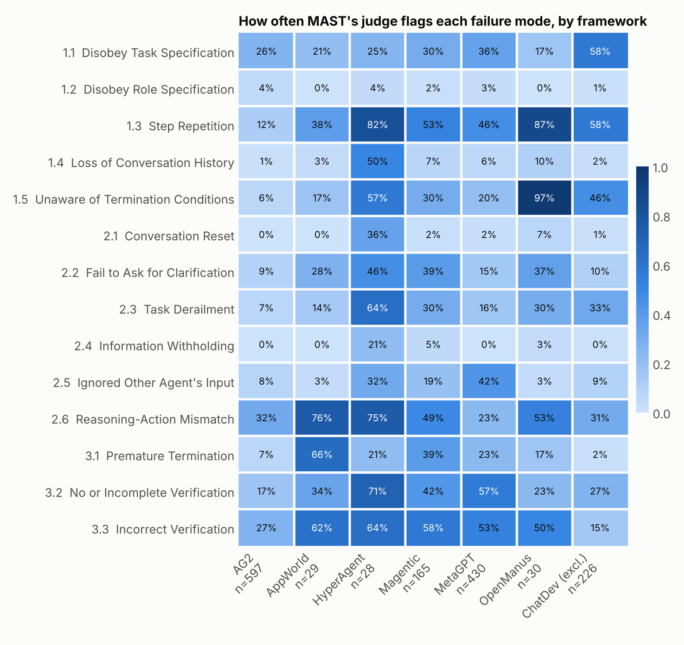

# AFACS: layered failure analysis of LLM multi-agent traces

**James Le Cuirot** · Senior First Officer and Flight Safety Officer · MSc Human Factors in Aviation

> **Status (November 2026): work in progress.** The pipeline, the MAST data audit, codebook v1 (draft) and the cross-walk to Ezell et al. (2025) are complete; the AI pilot results are pending. The paper draft is in [`paper/afacs.pdf`](paper/afacs.pdf). Sections marked *[pending]* are placeholders. A plain-English guide to the whole project is in [`docs/GUIDE.md`](docs/GUIDE.md).

*AFACS is a working name (Agent Failure Analysis and Classification System).*

---

## Summary

Existing taxonomies of LLM-agent failures give each failure one flat label, e.g. "Disobey Task Specification". Aviation safety science learned decades ago that flat labels hide two things: the **latent conditions** beneath the visible unsafe act (Reason's Swiss-cheese model; HFACS), and the difference between an **error** and a **violation**. For AI systems the second distinction roughly separates *capability* failures from *alignment* failures. This project builds on the AI-agent incident framework of Ezell, Roberts-Gaal & Chan (2025), which was written for single agents and not tested on data. It extends that framework to multi-agent systems using the structure of the Human Factors Analysis and Classification System (HFACS): a supervision/orchestration tier, coordination between agents, and violations with graded evidence. It then asks four questions of the public MAST traces: how the two frameworks map onto each other, whether real logs contain the information Ezell et al. say investigators need, whether the extended framework can be applied consistently, and how MAST's flat labels map onto it. Validation against human coders is planned as a second study.

## 1. Motivation

When an aircraft incident is investigated, "pilot error" is where the analysis starts, not where it ends. HFACS (Shappell & Wiegmann, 2000), built on Reason's model of organisational accidents (Reason, 1990, 1997), asks what preconditions, supervisory failures and organisational decisions made the unsafe act likely, and it separates *errors* (unintended slips, lapses and mistakes) from *violations* (departures from known rules). Both moves changed what the industry fixes: training and design rather than blame, and different remedies for people who could not comply versus people who chose not to.

LLM agent research is at the "pilot error" stage. The most widely used multi-agent failure taxonomy, MAST (Cemri et al., 2025), assigns each failed trace one or more of 14 flat categories. A category such as *FM-1.1 Disobey Task Specification* can cover an agent that misread an ambiguous task, an agent that saw a clear requirement and ignored it, and (as we show below) an agent that was never given a task at all. These are different problems with different fixes, and for AI safety the distinction between "could not" and "did not" is central.

## 2. The AFACS framework

Each failed trace is coded at every layer where the trace provides evidence (multi-label), with a deepest contributing layer and a confidence rating. Full definitions: [`codebook/v0.md`](codebook/v0.md).

| Layer | Codes |
|---|---|
| **L4 Organisational / design influences** | L4.1 Architecture and role design · L4.2 Resource provisioning · L4.3 Process |
| **L3 Supervision / orchestration** | L3.1 Inadequate supervision · L3.2 Planned inappropriate operation · L3.3 Failure to correct a known problem · L3.4 Deficient specification |
| **L2 Preconditions** | L2.1 Environment · L2.2 Agent state · L2.3 Coordination (the crew-resource-management analogue) |
| **L1 Unsafe acts** | Errors: L1.E1 Skill-based · L1.E2 Decision · L1.E3 Perceptual. Violations: L1.V1 Routine · L1.V2 Exceptional · L1.V? Indeterminate |

**Violation evidence rule.** A failure is coded as a violation only if (1) the requirement was in the agent's accessible context, (2) the trace shows the agent represented it, or the deviation cannot plausibly be accidental (e.g. hardcoding expected test outputs), and (3) the agent proceeded otherwise. If all three hold but the evidence is thin, it is coded indeterminate (`L1.V?`); otherwise it is an error. **This is a behavioural classification, not a claim about model intent or mental states.**

## 3. Data

We use MAST's public dataset (`mcemri/MAST-Data`, CC-BY-4.0): 1,642 traces from seven multi-agent frameworks (AG2, MetaGPT, ChatDev, Magentic-One, AppWorld, HyperAgent, OpenManus), labelled with MAST's 14 failure modes by an LLM judge (o1). Before building on the labels we audited the data ([`docs/data_audit.md`](docs/data_audit.md)):

- **Duplicates.** 1,642 rows hold 1,537 distinct traces.
- **MAST's judge is only moderately consistent with itself.** Thirty Magentic traces appear twice, labelled in separate judge runs. The two labellings agree with a mean per-code Cohen's κ of 0.43, ranging from about 0.67 to below zero depending on the failure mode (figure below). The flat labels we compare against are therefore noisy.
- **A corrupt group.** One group (ChatDev with CodeLlama) holds 100 rows but only 30 distinct texts, with labels unrelated to the text; it is excluded.
- **Metadata errors** (the OpenManus traces are GAIA questions, not a programming benchmark; two "HyperAgent" traces are ChatDev logs) are corrected or excluded. OpenManus logs print only the first ~50 characters of each task; the rendered traces say so.
- **Harness defects.** Five traces have an empty task; MAST nevertheless labels them, e.g., *Disobey Task Specification*.
- **The human-labelled subset is unusable.** In `MAD_human_labelled_dataset.json`, different traces within each annotation round carry identical labels, contradicting the original annotation sheets published in MAST's repository, so we do not use it.
- **No ground-truth outcome.** MAST does not record task success, so a "failed" trace means one the MAST judge flagged.




After quality exclusions, and excluding ChatDev (traces of 60k–500k tokens are too long to hand-code) and any trace over ~30k tokens, the eligible pool is 893 MAST-failed traces across six frameworks.

## 4. Method

1. **Ingest and render.** Each trace is split into numbered steps by a framework-specific parser that keeps agent text verbatim, and rendered as markdown with MAST labels and benchmark answers hidden.
2. **Cross-walk (RQ1).** Ezell et al.'s Appendix A taxonomy is mapped item by item onto AFACS ([`docs/crosswalk_ezell.md`](docs/crosswalk_ezell.md)); the mapping motivates codebook v1 ([`codebook/v1.md`](codebook/v1.md)).
3. **Information audit (RQ2).** MAST's logs are checked, framework by framework, against the 18 information items of Ezell et al.'s Table 1 ([`docs/information_audit.md`](docs/information_audit.md)).
4. **AI pilot (RQ3, RQ4).** Claude (`claude-sonnet-5-5`, with `claude-opus-5-5` as a second annotator and a re-run for test-retest) codes a sample of 250 failed traces, balanced across frameworks and models, through Claude Code's headless mode. The reply is structured JSON restricted to codebook codes, with step-referenced evidence and an evidence grade for any violation. Agreement is Cohen's κ per layer and per code (averaged, never pooled), with bootstrap 95% CIs, set against MAST's judge agreeing with itself at κ 0.43. This measures consistency, not correctness. Overall figures are weighted back to the eligible pool.
5. **Planned validation (second study).** A frozen, pre-registered calibration set of 30 traces (26 failed, 4 blind controls; dev/test 18/12; SHA-256 of the hidden key committed) will be coded by recruited human coders using the Coding Desk. The AI pilot never touches these traces.

## 5. Results *[pending]*

- **RQ1, cross-walk:** see [`docs/crosswalk_ezell.md`](docs/crosswalk_ezell.md).
- **RQ2, information adequacy:** see [`docs/information_audit.md`](docs/information_audit.md).
- **RQ3, applicability:** *[pending: model–model and run–rerun κ; prevalence of supervision, coordination and graded violations]*
- **RQ4, MAST labels:** *[pending: MAST × AFACS heatmap]*

## 6. Case studies *[pending]*

*[Three or four traces where layered coding changes the story. Candidate: an empty-task MetaGPT trace that MAST labels "Disobey Task Specification" and "Fail to Ask for Clarification".]*

## 7. Limitations

- **Behavioural, not intentional.** "Violation" describes what the trace shows, not what a model "wanted".
- **No human validation yet.** The AI pilot shows whether the framework is applied consistently, not whether the codes are right; that needs the planned human study. HFACS reliability is itself contested in the human-factors literature (Olsen & Shorrock, 2010; Cohen et al., 2015).
- **Small samples per framework.** Some frameworks contribute only 13–23 traces to the pilot; their intervals are wide, and they are reported, not hidden.
- **Noisy reference labels.** MAST's labels come from an LLM judge with moderate test-retest agreement and no ground-truth task outcome.
- **Coverage.** ChatDev and very long traces are excluded; most frameworks ran a single model, so model comparisons are exploratory; "Claude" in MAST carries no version number.
- **Stochastic annotator.** Current Claude models cannot be made fully deterministic; LLM–LLM agreement measures this.

## 8. Future work

*Phase 2* applies AFACS to a domain evaluation: aviation dispatch and safety decisions under pressure. Each scenario has a ground-truth answer (MEL, flight-time limitation, weather minima or fuel decision) and is run in neutral, commercial-pressure, authority-pressure and user-frustration variants. We measure how often the safe answer survives the pressure, and code the failures with AFACS, especially error versus violation. Built in UK AISI's Inspect framework from public regulatory sources only.

## 9. Related work

*Annotated bibliography with full references: [`docs/related_work.md`](docs/related_work.md); BibTeX: [`docs/references.bib`](docs/references.bib).*

**Agent failure taxonomies.** MAST (Cemri et al., 2025) is the most widely used taxonomy of multi-agent failures and draws on organisational safety theory, but its 14 modes are flat. TRAIL (Deshpande et al., 2025) separates reasoning, planning and system-execution errors in 148 human-annotated traces, and finds that LLMs localise them poorly. AgentErrorBench (Zhu et al., 2025) classifies failures by the agent component that broke. Who&When (Zhang et al., 2025) asks *which agent, at which step*, and finds step-level attribution hard (14% accuracy). Raj et al. (2026) locate faults by where the fix belongs, model or harness, with an LLM judge reaching κ = 0.76 against human labels. None of these separates latent conditions from unsafe acts, or errors from violations.

**Safety science applied to AI agents.** The nearest prior work is Ezell, Roberts-Gaal & Chan (2025), who cite HFACS and propose a three-part "chain of causes" for agent incidents (system, contextual and cognitive factors). Their framework is conceptual, codes no traces, has no supervision tier, and has no violations. AFACS puts this direction into practice with the full HFACS structure, a behavioural violation rule, and an empirical reliability test. STPA-based work on AI control looks forward at hazards. AFACS looks back at what traces show, so the two are complementary.

**HFACS and its reliability.** HFACS (Shappell & Wiegmann, 2000; Wiegmann & Shappell, 2003) builds on Reason's latent/active failure model (Reason, 1990, 1997). The error/violation distinction has empirical support as two different kinds of failure (Reason et al., 1990). The closest methodological precedent is Wiegmann & Shappell (2001): an aviation psychologist and a commercially rated pilot independently re-coded 319 NTSB causal factors into HFACS, with κ = 0.71. Unlike that study, AFACS codes the raw traces rather than causes already identified by investigators. HFACS reliability is contested: Olsen & Shorrock (2010) found low agreement for a modified version, and a review by Cohen et al. (2015) found reliability higher with training and with fewer departures from the original. This is why AFACS stays close to the original tiers and reports agreement at layer as well as code level.

**AI behaviours that look like violations.** Specification gaming and reward hacking in coding agents give concrete cases of "exceptional violations". ImpossibleBench (Zhong et al., 2025) builds tasks where passing *requires* breaking the specification, an experimental version of the "cannot plausibly be accidental" criterion. Baker et al. (2025) show reasoning traces can reveal reward hacking, but that models trained against monitors learn to hide it, so absence of incriminating reasoning is not proof of an honest error. OverclaimBench (Smyth et al., 2026) measures false claims of completion from transcripts alone, "requiring no inference about intent", which is the same behavioural stance as the AFACS violation rule. At the aggregate level, Hägele et al. (2026) ask whether AI failures look more like coherent misalignment or an incoherent "hot mess", a statistical form of the error-versus-violation question that AFACS addresses trace by trace.

## Reproducing

```bash
uv sync                          # Python 3.11+, installs pinned dependencies
uv run afacs-ingest              # download (pinned, hash-checked), clean, parse, audit
uv run afacs-sample calibration --renders-only  # check the frozen calibration set, write its renders
uv run afacs-sample bulk
uv run afacs-analysis mast       # figures above
uv run pytest                    # tests
```

Annotation needs an Anthropic API key in `.env` (see `.env.example`); `uv run afacs-annotate estimate --set bulk` prints a cost estimate first. Traces are not committed: they contain benchmark questions whose maintainers ask that they not be reposted in crawlable form.

## Licences and acknowledgements

Code: MIT. Data: MAST dataset by Cemri et al., CC-BY-4.0, used with attribution. The analysis pipeline was built with Claude Code; the framework, codebook and expert coding are the author's. No material from any employer is used; all data is public.
