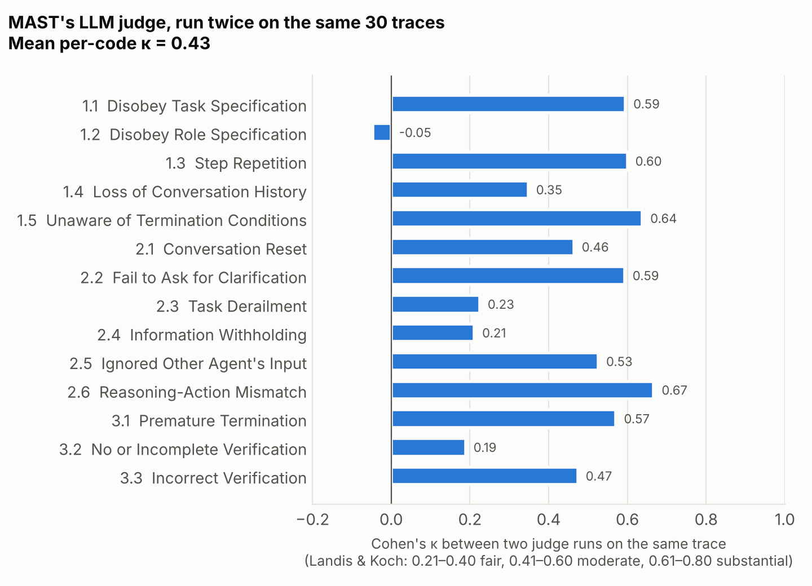
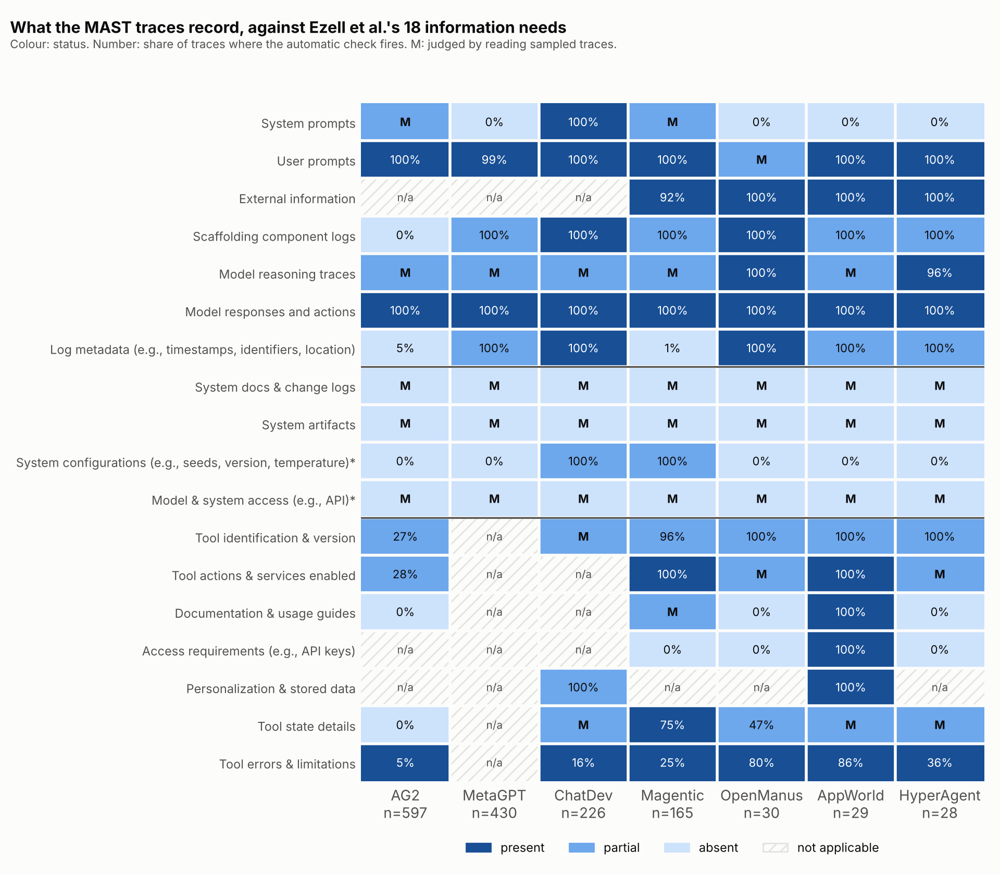
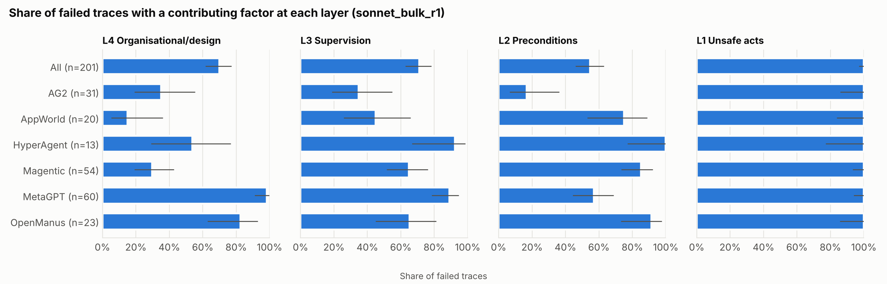
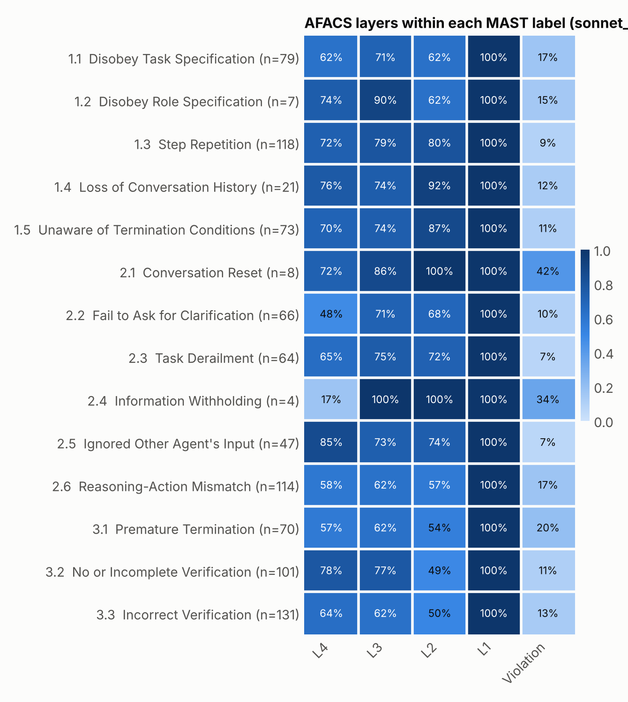

# Extending AI-Agent Incident Analysis to Multi-Agent Systems

**AFACS, an HFACS-based framework, and an audit of public traces**

James Le Cuirot · [CitadelAero](https://citadelaero.com) · Senior First Officer and Flight Safety Officer · MSc Human Factors in Aviation · james@citadelaero.com

**Paper (draft, November 2026): [`paper/afacs.pdf`](paper/afacs.pdf)** · Plain-English guide to the project: [`docs/GUIDE.md`](docs/GUIDE.md)

*AFACS stands for Agent Failure Analysis and Classification System.*

---

## In brief

When an aircraft accident is investigated, "pilot error" is where the analysis starts, not where it ends. Failure analysis of AI agents is still largely at the "pilot error" stage: each failed run gets a flat label.

This project extends the AI-agent incident framework of Ezell, Roberts-Gaal & Chan (2025) to multi-agent systems, using the structure of aviation's Human Factors Analysis and Classification System (HFACS). It adds three things:
- a supervision and orchestration tier;
- a coordination category, the counterpart of crew resource management;
- violations, coded from behaviour with a graded statement of the evidence.

The framework is then tested on the public [MAST](https://github.com/multi-agent-systems-failure-taxonomy/MAST) dataset of multi-agent traces.

**Main findings**

- **MAST's data has quality problems.**
  - Its 1,642 rows hold 1,537 distinct traces, and one group of 100 rows holds only 30 distinct texts.
  - MAST's AI judge agrees with itself at a mean Cohen's κ of only 0.43 on traces it labelled twice.
  - Its descriptions of some systems differ from what its logs show was run.
- **The logs record actions but not systems.** Every framework's logs record what the agents said and did. None contains the system documentation, versions or settings that an investigator would need to reconstruct a failure.
- **AFACS can be applied consistently.** Claude coded 250 failed traces three times. Agreement on which layers were involved was κ 0.63–0.76 between two models and 0.74–0.87 between two runs of one model. Individual codes agreed less (0.52 and 0.59).
- **Most failures have causes below the sharp end.**
  - 85–91% of failures have a contributing factor beneath the unsafe act.
  - Supervision failures appear in about two-thirds of failures and coordination breakdowns in about two-fifths.
  - Violations appear in 9–13% and are concentrated in two frameworks.
  - MAST's "Disobey Task Specification" label mixes errors with violations.
- **Design causes need design evidence.** The AI's design-level codes are inferences from traces. Checked against the frameworks' documentation and code, its design claims usually pointed at a real weakness but overstated it as an absence: 8 of 24 were confirmed in full, 13 in part and 2 were contradicted.

This study measures **consistency, not correctness**. Validation with independent human coders is planned as a second study, on a calibration set that has already been frozen and pre-registered.

## The framework

Each failed trace is coded at every layer where the trace gives evidence, with a deepest contributing layer and a confidence rating. Full definitions are in the codebook ([`codebook/v1.1.md`](codebook/v1.1.md); the pilot used [`v1`](codebook/v1.md)).

| Layer | Codes |
|---|---|
| **L4 Organisational / design** | L4.1 Architecture and role design · L4.2 Resource provisioning · L4.3 Process · L4.4 Model development *(developer evidence only)* · L4.5 Operation set-up |
| **L3 Supervision / orchestration** | L3.1 Inadequate supervision · L3.2 Planned inappropriate operation · L3.3 Failure to correct a known problem · L3.4 Deficient specification |
| **L2 Preconditions** | L2.1 Environment · L2.2 Agent state · L2.3 Coordination |
| **L1 Unsafe acts** | Errors: L1.E1 Skill-based · L1.E2 Decision · L1.E3 Perceptual. Violations: L1.V1 Routine · L1.V2 Exceptional · L1.V? Indeterminate |

**Violations, from behaviour.** A failure is coded as a violation only if all three of these hold:
1. The requirement was in the agent's context.
2. The trace shows the agent registered it, or the departure cannot plausibly be accidental (for example, hard-coding an expected answer).
3. The agent did otherwise.

Each violation carries an evidence grade:
- *stated*: the agent's own words acknowledge the requirement;
- *inferred*: only the nature of the act shows it;
- *thin*: the criteria seem to hold but the evidence is weak.

This is a behavioural classification. It makes no claim about intent.

**Layered evidence.** Each layer is coded only from evidence an investigator in that position could hold. Unsafe acts and preconditions are visible in a trace; design factors need design records. Model development (L4.4) needs the developer's records, so it is never coded from a trace alone. A cross-walk maps every factor in Ezell et al.'s taxonomy onto AFACS ([`docs/crosswalk_ezell.md`](docs/crosswalk_ezell.md)).

## Results

### The MAST data

[`docs/data_audit.md`](docs/data_audit.md) has the full audit. In short:

- **Duplicates:** 1,642 rows hold 1,537 distinct traces.
- **A corrupt group:** one group of 100 rows contains 30 distinct texts with unrelated labels.
- **Misfiled and mislabelled traces:**
  - two traces are filed under the wrong framework;
  - the OpenManus traces are GAIA questions but are tagged as programming tasks;
  - five runs were launched with an empty task.
- **A noisy judge:** MAST's judge labelled 30 traces twice and agreed with itself at a mean per-mode κ of 0.43.
- **No outcome record:** there is no record of whether tasks succeeded.
- **Discrepancies with MAST's own descriptions:**
  - MetaGPT is described as having a verifier, but the logs show a three-role example in which nothing checks the code.
  - The HyperAgent traces, taken from a September 2024 public submission, are labelled with a model released later.



### What the logs let an investigator establish (RQ2)

MAST's logs were checked against the eighteen kinds of information Ezell et al. say investigators need ([`docs/information_audit.md`](docs/information_audit.md)).



### How consistently AFACS can be applied (RQ3)

Claude coded the 250-trace bulk sample three times (`claude-sonnet-5-5` twice, `claude-opus-5-5` once) through Claude Code. Cohen's κ, with 95% bootstrap intervals:

| Measure | Sonnet vs Opus | Sonnet run 1 vs run 2 |
|---|---|---|
| L4 present | 0.71 (0.62–0.79) | 0.74 (0.65–0.82) |
| L3 present | 0.63 (0.53–0.72) | 0.74 (0.65–0.82) |
| L2 present | 0.75 (0.67–0.83) | 0.76 (0.67–0.83) |
| L1 present | 0.76 (0.65–0.86) | 0.87 (0.78–0.94) |
| Individual codes (mean per code) | 0.52 (0.45–0.57) | 0.59 (0.53–0.66) |
| Violation vs error | 0.67 (0.51–0.81) | 0.68 (0.50–0.83) |
| Deepest layer (weighted) | 0.75 (0.68–0.82) | 0.80 (0.73–0.86) |
| Failure observed | 0.69 (0.57–0.79) | 0.80 (0.70–0.88) |

**The AI's evidence was genuine.** Every coding cites verbatim quotes from the trace, and each quote was checked automatically against the step it cites. 99.6–99.9% were found there, and none was invented.

**Where failures sit.** Shares of failed traces, weighted to represent the eligible pool:



### What MAST's flat labels hide (RQ4)

Within every MAST failure mode, the AFACS coding spreads across layers, and some modes mix errors with violations:



### Design claims against documentation

The AI's 24 most frequent design claims were checked against each framework's paper, documentation and code ([`docs/design_check.md`](docs/design_check.md)):

| Verdict | Claims |
|---|---|
| Confirmed in full | 8 |
| Partly true | 13 |
| Contradicted | 2 |
| Not settled | 1 |

The typical error was calling a weak safeguard a missing one: "no loop detection" where a loop detector exists but only nudges. A trace cannot tell the two apart, so design factors coded from traces alone mean "no effective safeguard visible in the trace".

Worked examples of what the layered coding shows are in section 6 of the paper.

## Limitations

- **Consistency, not correctness.** Two runs of a model can share a mistake. Only independent human coding can show which codes are right, and that is the next study.
- **Behavioural, not intentional.** "Violation" describes what the trace shows, not what a model wanted. A model's stated reasoning may not reflect what produced its action.
- **Design factors are inferred from traces,** and the documentation check shows they tend to overstate absences.
- **Outcomes were hidden from the annotator,** to avoid hindsight bias. As a result it cannot tell, for example, whether a maths answer was wrong.
- **"No unsafe act" was never coded.** The annotator never coded a failure without an unsafe act, although the codebook allows it.
- **The cross-walk pairing is not a test.** The pairing of HFACS error types with Ezell et al.'s cognitive functions cannot be read as support for the cross-walk, because the codebook version the annotator read stated it (removed in v1.1).
- **Coverage and confounding.**
  - ChatDev and traces over about 30,000 tokens are excluded.
  - Model is confounded with framework, so model comparisons are exploratory.
- **HFACS's own reliability is debated** in the human-factors literature.

## Repository

| Path | What it is |
|---|---|
| [`paper/`](paper/) | The paper (LaTeX source and PDF) |
| [`codebook/`](codebook/) | The AFACS codebook: v0 (first draft), v1 (used in the AI pilot), v1.1 (current) |
| [`docs/`](docs/) | Cross-walk, data audit, information audit, design check, related work, references, and a plain-English guide |
| [`results/`](results/) | Analysis and agreement reports for each run, and a plain-English summary of the pilot |
| [`figures/`](figures/) | All figures |
| [`annotations/llm/public/`](annotations/llm/public/) | The AI codings (quotes encoded; see below) |
| [`annotations/human/`](annotations/human/) | The blank calibration sheet and the fingerprint of the frozen calibration key |
| [`prompts/`](prompts/) | The annotator's instructions |
| [`src/afacs/`](src/afacs/) | The pipeline; every study-design choice is recorded with its reason in `design.py` |
| [`scripts/pilot.py`](scripts/pilot.py) | Runs the three annotation passes |
| [`tests/`](tests/) | Automated tests (`uv run pytest`) |

## Reproducing

The pipeline needs Python 3.11+ and [uv](https://docs.astral.sh/uv/).

```bash
uv sync                                      # install pinned dependencies
uv run afacs-ingest                          # download MAST (pinned revision, hash-checked), clean, parse, audit
uv run afacs-sample calibration --verify     # re-draw the calibration set and check it matches the frozen one
uv run afacs-sample bulk                     # the 250-trace bulk sample
uv run afacs-analysis mast                   # data-audit figures
uv run afacs-info-audit                      # RQ2
for r in sonnet_bulk_r1 opus_bulk_r1 sonnet_bulk_r2; do uv run afacs-annotate restore --run-name $r; done
uv run afacs-analysis afacs --run sonnet_bulk_r1
uv run afacs-agreement llm-vs-llm --run-a sonnet_bulk_r1 --run-b opus_bulk_r1
uv run afacs-agreement llm-vs-llm --run-a sonnet_bulk_r1 --run-b sonnet_bulk_r2
uv run pytest
```

To re-run the annotation itself, use `uv run python scripts/pilot.py`. It calls Claude through Claude Code's headless mode, so it uses a signed-in Claude subscription. `uv run afacs-annotate run --backend api ...` uses the Anthropic API instead and needs `ANTHROPIC_API_KEY` in `.env`. Every annotation records the model, prompt and codebook versions, and a hash of the full instructions.

## Data handling

- **Traces are not committed.** They contain benchmark questions (GAIA, AppWorld, SWE-bench) whose maintainers ask that they not be reposted where web crawlers can read them. `afacs-ingest` recreates them from the pinned MAST revision.
- **The AI codings are committed with their quotes encoded.** Codes are readable in plain text. The quotes and summaries, which reproduce pieces of the traces, are encoded and carry a canary string. `afacs-annotate restore` decodes them.
- **Public data only.** No material from any employer is used.

## Licences, AI use and citation

- **Code:** MIT licence, © 2026 CitadelAero Limited. **Data:** MAST dataset by Cemri et al., CC-BY-4.0, used with attribution.
- **Competing interests:** the author's company, CitadelAero, works on AI for aviation, the area of the aviation evaluation proposed as future work. This study received no external funding and uses only public data.
- **AI use:**
  - The data pipeline, tests, figures and much of the drafting were done with Claude Code under the author's direction.
  - The AI pilot's annotations were produced by Claude models.
  - The worked examples and the documentation check were prepared with Claude and checked against the traces and sources they cite.
  - The framework and the codebook decisions are the author's.

```bibtex
@misc{lecuirot2026afacs,
  author = {Le Cuirot, James},
  title  = {Extending AI-Agent Incident Analysis to Multi-Agent Systems: AFACS, an HFACS-based Framework, and an Audit of Public Traces},
  year   = {2026},
  note   = {CitadelAero. Draft, November 2026},
  url    = {https://github.com/JamesLEC1999/Research}
}
```

**Related work** (annotated, with full references): [`docs/related_work.md`](docs/related_work.md) · BibTeX: [`docs/references.bib`](docs/references.bib)
